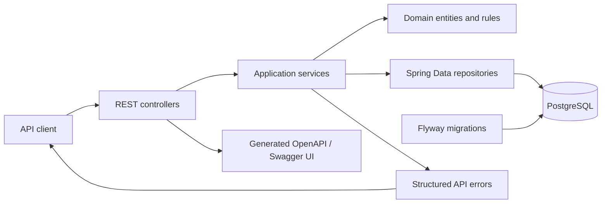
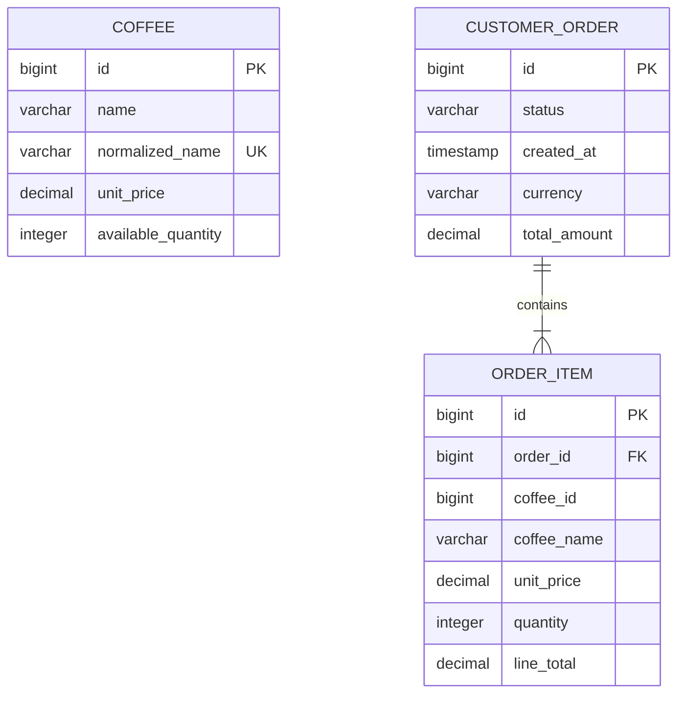

# Architecture

Coffee App is a layered Spring Boot API. The project is organized by feature so that catalog and order responsibilities can evolve independently while sharing a consistent error and API-documentation boundary.



## Package layout

| Package | Responsibility |
| --- | --- |
| `catalog.api` | Catalog request and response models plus HTTP endpoints. |
| `catalog.application` | Catalog use cases and cross-feature policy ports. |
| `catalog.domain` | Coffee state, normalization, and domain exceptions. |
| `catalog.persistence` | Catalog repository queries and locks. |
| `order.api` | Order request and response models plus HTTP endpoints. |
| `order.application` | Transactional ordering and cancellation use cases. |
| `order.domain` | Order aggregate, item snapshots, lifecycle state, and exceptions. |
| `order.persistence` | Order retrieval and active-order queries. |
| `shared.error` | One consistent public error format. |
| `shared.openapi` / `shared.time` | Application-wide API metadata and time dependency. |

## Ordering consistency model

Order placement is one transaction. Requested coffee rows are locked in ascending identifier order before inventory is changed. The ordered lock sequence is intentional: it gives concurrent order requests a consistent acquisition order.

```mermaid
sequenceDiagram
    participant C as Client
    participant O as Order controller
    participant S as Order service
    participant R as Coffee repository
    participant D as PostgreSQL

    C->>O: POST /api/orders
    O->>S: place(request)
    S->>R: lock coffee rows by ascending ID
    R->>D: SELECT ... FOR UPDATE
    alt all items exist and inventory is sufficient
        S->>S: decrement inventory and create price/name snapshots
        S->>D: persist order and items
        S-->>O: placed order
        O-->>C: 201 Created
    else invalid or insufficient item
        S-->>O: domain exception
        O-->>C: structured 4xx error
        Note over S,D: Transaction rolls back; inventory is unchanged
    end
```

Order items intentionally store `coffeeId`, name, and unit price as historical snapshots. There is no foreign key from `order_item.coffee_id` to the live catalog so that cancelled historical orders remain readable after their catalog item is deleted. A catalog item in a `PLACED` order cannot be deleted.

## Data ownership



Flyway owns schema evolution. JPA validates the resulting schema rather than generating it. Production configuration takes database connection values from `DB_URL`, `DB_USERNAME`, and `DB_PASSWORD`; the test profile uses an isolated in-memory H2 database with the documented H2 `SA` account only for tests.
