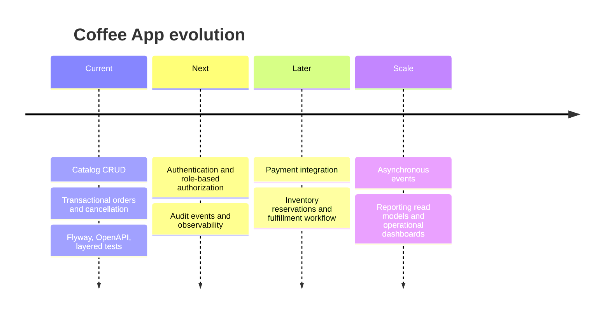

# Product and Technical Roadmap

This portfolio project has a deliberately bounded local scope. PostgreSQL migrations, Testcontainers acceptance tests, Docker Compose, and GitHub Actions verification are already delivered. The following items describe optional future investments.

## Functional direction

- Add customer identities, staff roles, and authorization around catalog administration.
- Scope idempotency records to authenticated customers once customer identities exist; the current bounded API uses global keys.
- Introduce an inventory reservation or fulfillment state machine when order preparation becomes asynchronous.
- Add search, filtering, and pagination as the catalog grows.

## Architecture direction

- Publish domain events after committed order state changes to keep future notifications and analytics decoupled from the order transaction.
- Add an outbox pattern before integrating external services so business state and event delivery are reliable.
- Separate read-oriented reporting models only when reporting needs justify the additional complexity.

## Operational direction

- Add authenticated production profiles, secret management, health checks, structured logs, metrics, and trace correlation.
- Extend the existing migration and PostgreSQL acceptance CI only when new behavior requires it.
- Define database backup, retention, and recovery expectations before treating the service as deployable production software.
