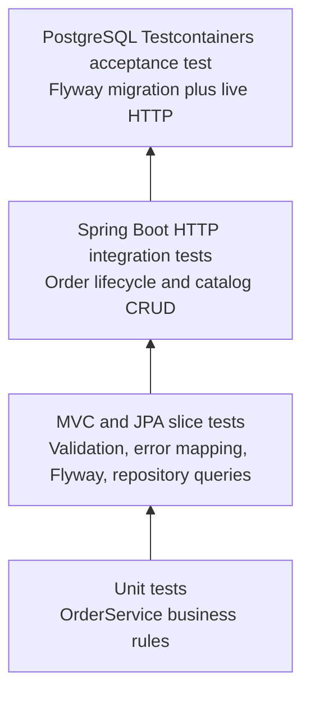

# Testing Strategy and Test Plan

The test suite follows a deliberate pyramid: fast tests protect business rules first, while slower tests verify framework wiring, persistence, and the public HTTP contract. Every layer has a distinct purpose; the same behavior is not copied indiscriminately across all layers.



| Layer | Scope | Examples | Runtime expectation |
| --- | --- | --- | --- |
| Unit | One class with mocked collaborators | Duplicate lines, insufficient inventory, snapshots, single cancellation | Fast and deterministic |
| MVC slice | Controller and validation/error boundary | Create location, replacement mapping, invalid JSON payloads, and domain-exception mapping | No database |
| JPA slice | Repository and Flyway-backed schema | Seed data and deterministic lock-query ordering | H2 in PostgreSQL compatibility mode |
| HTTP integration | Application through `MockMvc` | Catalog CRUD, order placement, rollback, snapshots, cancel, delete guard | In-memory H2 test profile |
| Black-box HTTP | Running embedded application exercised with REST Assured | Create → update → order → retrieve → cancel → delete | In-memory H2 test profile |
| Acceptance | Running server plus real PostgreSQL | Flyway migration, concurrency, and database-constraint behavior through HTTP | Testcontainers / Docker |
| Browser E2E | Playwright against a running Spring Boot test profile | Catalog → cart → order → manual lookup after reload → cancellation; invalid quantity feedback | Chromium and isolated H2 |

## Primary scenarios

- Catalog create, list, retrieve, replace, delete, validation, and case-insensitive duplicate-name conflict.
- Order placement with inventory decrement and immutable item snapshots.
- Atomic rollback when a request includes an unknown coffee or exceeds available inventory.
- Duplicate coffee-line rejection before inventory is locked or an order is written.
- One-time cancellation, inventory restoration, and deletion allowed only after the order is cancelled.
- Generated OpenAPI and Swagger UI availability.
- A full REST Assured HTTP workflow from catalog creation through deletion after cancellation.
- A PostgreSQL-only concurrent-order check: exactly one request may purchase the final available item.
- A PostgreSQL-only concurrent-cancellation check: two overlapping requests produce one success and one `ORDER_ALREADY_CANCELLED` conflict, with stock restored exactly once.
- A PostgreSQL-only concurrent normalized-name conflict check: one insert wins and the competing API request returns `COFFEE_NAME_ALREADY_EXISTS`.
- Invalid request bodies, fractional or coerced integer values, order-total precision boundaries, inventory-restocking overflow, and framework request errors return structured API errors without partial state changes.
- A required `Idempotency-Key` produces one order and one inventory decrement; a matching replay returns the original order and a changed request receives `IDEMPOTENCY_KEY_REUSED`.
- The browser regression exercises the customer-visible catalog, cart, checkout, manual order lookup after a page reload, cancellation, and invalid-quantity feedback.

## Risk-to-test map

| Business rule | Failure risk | Automated evidence | Independent oracle |
| --- | --- | --- | --- |
| An order changes inventory atomically. | A later invalid line leaves an earlier decrement persisted. | PostgreSQL acceptance test submits an available line followed by an insufficient one. | JDBC checks both stock values plus `customer_order` and `order_item` row counts. |
| An order can be cancelled once. | Concurrent requests restore the same inventory twice. | PostgreSQL acceptance test holds the order lock and releases two HTTP cancellation requests together. | JDBC checks final stock and status; one response must be `ORDER_ALREADY_CANCELLED`. |
| A catalog name is unique after normalization. | A race reaches the database and becomes a 500 error. | PostgreSQL acceptance test holds an uncommitted matching insert while an API create request waits. | JDBC confirms one normalized name; the API returns `COFFEE_NAME_ALREADY_EXISTS`. |
| Historical order data remains readable after catalog cleanup. | Deleting a cancelled catalog item destroys order history. | PostgreSQL acceptance test places, cancels, deletes, and retrieves an order. | JDBC confirms the historical order-item row remains. |
| Client input is explicit and bounded. | Null values, coercion, or numeric overflow become a 500 or partial write. | MVC tests cover malformed payloads, null lines, invalid integers, precision boundaries, and restocking overflow. | HTTP error code and follow-up resource reads confirm a controlled response and unchanged state. |

The test count is not a release criterion by itself. Each row identifies the business rule, the failure mode, the automated scenario, and the observable result that distinguishes a valid outcome from a superficially passing response.

## Running tests

```bash
mvn verify
```

`mvn test` runs the fast H2-backed suite. `mvn verify` also runs the required PostgreSQL/Testcontainers acceptance suite against `postgres:16-alpine`, creates a JaCoCo HTML report at `target/site/jacoco/index.html`, and fails when Docker is unavailable. This makes a green full verification evidence that every required test layer executed. The current local verification completed 42 tests without failures, errors, or skips. GitHub Actions runs the same clean verification and retains Surefire, Failsafe, and JaCoCo reports; its remote execution remains unverified until a repository remote is approved and configured.

## Test data and secrets

The H2 test profile uses `SA` with an empty password because the database is ephemeral and exists only during test execution. It is not a deployable account and no production credential is committed. Production database values are supplied by environment variables.

## Concurrent cancellation regression

`shouldRestoreInventoryExactlyOnceWhenCancellationsOverlap` holds the order row in a separate database transaction, submits two HTTP cancellation requests, and waits for both requests to block on that row before releasing it. The database observation loop, competing cancellation HTTP calls, and worker completion have bounded waits. The final inventory and order status are checked through SQL as an independent oracle; the losing HTTP response must contain `ORDER_ALREADY_CANCELLED`.

On 2026-09-11 this regression failed against the prior query: both requests returned 200 and inventory became 2 instead of 1. The collection fetch join with `DISTINCT` caused Hibernate follow-on locking, which loaded order state before acquiring the lock. The corrected query locks only the order row first; items are loaded afterward inside the existing service transaction. The same regression then passed against PostgreSQL. This case demonstrates why an H2 test or a lock annotation alone cannot establish database concurrency behavior.

The duplicate-name regression inserts a normalized name in an uncommitted PostgreSQL transaction, waits for a competing API create request to reach the unique-index lock, and then commits. It proves the database preserves a single record and the API translates the race into the documented conflict rather than a server error.
