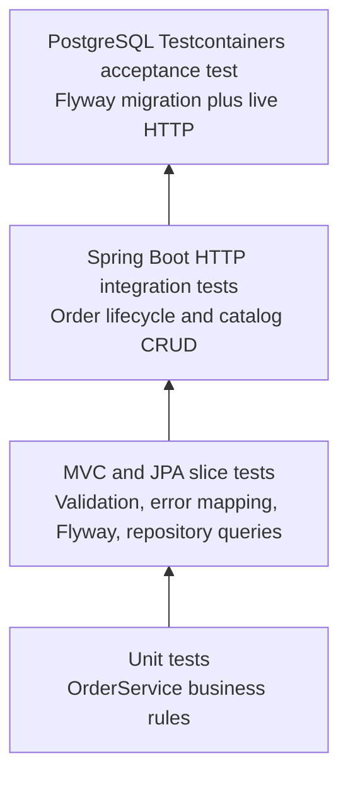

# Testing Strategy and Test Plan

The test suite follows a deliberate pyramid: fast tests protect business rules first, while slower tests verify framework wiring, persistence, and the public HTTP contract. Every layer has a distinct purpose; the same behavior is not copied indiscriminately across all layers.



| Layer | Scope | Examples | Runtime expectation |
| --- | --- | --- | --- |
| Unit | One class with mocked collaborators | Duplicate lines, insufficient inventory, snapshots, single cancellation | Fast and deterministic |
| MVC slice | Controller and validation/error boundary | Create location, replacement mapping, invalid JSON payloads, and domain-exception mapping | No database |
| JPA slice | Repository and Flyway-backed schema | Seed data and deterministic lock-query ordering | H2 in PostgreSQL compatibility mode |
| HTTP integration | Application through `MockMvc` | Catalog CRUD, order placement, rollback, snapshots, cancel, delete guard | In-memory H2 test profile |
| Black-box HTTP | Running embedded application exercised with REST Assured | Create → update → order → retrieve → cancel → delete | In-memory H2 test profile |
| Acceptance | Running server plus real PostgreSQL | Flyway seed data and concurrent last-item ordering through HTTP | Testcontainers / Docker |

## Primary scenarios

- Catalog create, list, retrieve, replace, delete, validation, and case-insensitive duplicate-name conflict.
- Order placement with inventory decrement and immutable item snapshots.
- Atomic rollback when a request includes an unknown coffee or exceeds available inventory.
- Duplicate coffee-line rejection before inventory is locked or an order is written.
- One-time cancellation, inventory restoration, and deletion allowed only after the order is cancelled.
- Generated OpenAPI and Swagger UI availability.
- A full REST Assured HTTP workflow from catalog creation through deletion after cancellation.
- A PostgreSQL-only concurrent-order check: exactly one request may purchase the final available item.

## Running tests

```bash
mvn verify
```

The default test profile is self-contained and uses H2 for its fast layers. When Docker is available, `mvn verify` also runs the PostgreSQL/Testcontainers acceptance suite against `postgres:16-alpine`; the latest local Docker-enabled verification completed all 31 tests without skips. When Docker is unavailable, only that acceptance class is intentionally skipped so the remaining local verification remains useful. The GitHub Actions workflow runs `mvn verify`; its remote execution is intentionally deferred until a repository remote is approved and configured.

## Test data and secrets

The H2 test profile uses `SA` with an empty password because the database is ephemeral and exists only during test execution. It is not a deployable account and no production credential is committed. Production database values are supplied by environment variables.
